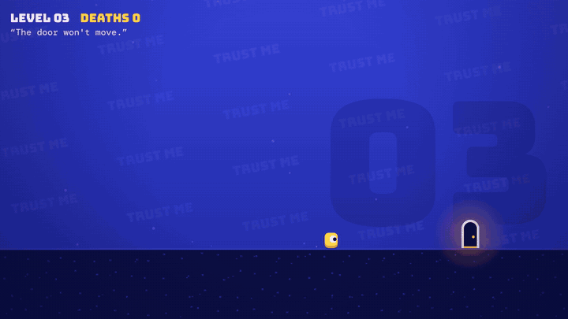
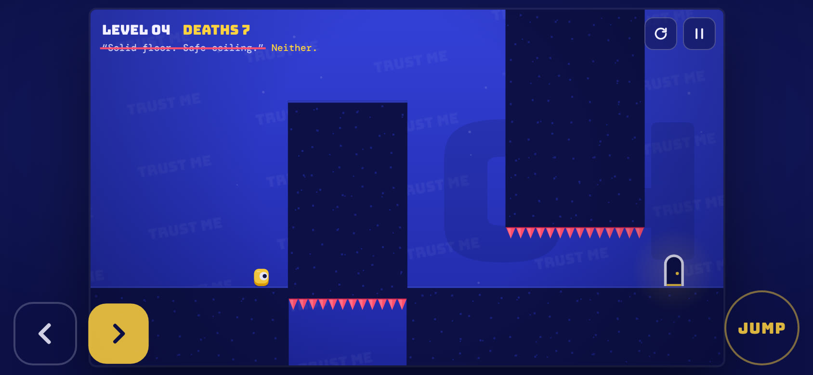

<div align="center">

<a href="https://jorgesousa.github.io/level-liar/"></a>

# LEVEL LIAR

*An ~~honest~~ platformer.*

**Ten levels. Each one makes you a promise. Every single promise is a lie.**

[](https://jorgesousa.github.io/level-liar/)

[](#made-for-thumbs)
[](index.html)
[](#test)
[](LICENSE)

</div>

---

You see a door. The level says *"Just walk to the door."* You walk to the door. The floor disappears.

LEVEL LIAR is a troll platformer that runs in your phone's browser. Every level is named after a promise, and the promise is the trap. Die once and the game owns up: the promise gets crossed out in the corner and the truth appears next to it. Then you try again, a little wiser and a lot less trusting.

<div align="center">
<a href="docs/media/trailer.mp4"></a>
<br><sub>▶ <a href="docs/media/trailer.mp4">Watch the 20-second trailer</a> (with sound). All the gameplay is the real game, played by a bot.</sub>
</div>

## The ten promises

| # | The level promises… |
|:-:|---|
| 01 | “Just walk to the door.” |
| 02 | “Nothing to see here.” |
| 03 | “The door won't move.” |
| 04 | “Solid floor. Safe ceiling.” |
| 05 | “Every platform is solid.” |
| 06 | “Controls work as expected.” |
| 07 | “No moving parts.” |
| 08 | “The exit is to the right.” |
| 09 | “Take your time.” |
| 10 | “Last level. Honest.” |

<details>
<summary><b>The truth</b> (spoilers, obviously)</summary>
<br>

| # | Promise | Truth |
|:-:|---|---|
| 01 | Just walk to the door. | Mind the floor. |
| 02 | Nothing to see here. | Spikes. Everywhere. |
| 03 | The door won't move. | It's shy. |
| 04 | Solid floor. Safe ceiling. | Neither. |
| 05 | Every platform is solid. | Some of them crumble. |
| 06 | Controls work as expected. | Left is right. Sometimes. |
| 07 | No moving parts. | It comes back. |
| 08 | The exit is to the right. | Look up. |
| 09 | Take your time. | Don't stop. |
| 10 | Last level. Honest. | That one was actually true. |

What happens in each level, and how to beat it: [docs/LEVELS.md](docs/LEVELS.md).
</details>

## Made for thumbs



Open the link on your phone and play. Turn it sideways for the big stage. Add it to your home screen and it opens full screen, like an app.

| | Phone | Keyboard |
|---|---|---|
| Move | Hold ◀ ▶ (slide your thumb between them) | ← → or A D |
| Jump | JUMP | ↑, W or Space |
| Restart the level | ↻ | R |
| Pause | ‖ | Esc or P |
| Sound on/off | Menu | M |

## What's in it

- **The lie is the level design.** Floors that drop, spikes that pop up or slide over, a door that runs away, a ceiling that comes down, platforms that crumble, controls that swap mid-level, a saw that comes back, a fake exit, a floor that collapses behind you.
- **Fair, in its own way.** Every trap fires the same way every time. You don't get unlucky, you get educated.
- **No tells.** Blocks are drawn without seams, so you can't spot which piece of floor is about to fall.
- **Feels good to die.** Squash and stretch, screen shake, a burst of pixels, a red flash and a taunt every time you respawn. A level clear sweeps in with "LIE #03 EXPOSED".
- **Keeps score.** A death counter that never resets during a run, your progress saved on the device, and an end screen with your deaths, time and a verdict you can copy and send to a friend.
- **Tiny.** One HTML file. Everything is drawn on a canvas, every sound is synthesised with the Web Audio API, and the only thing it loads is two fonts.

## Write your own lie

Each level is a small `build($)` function in [`index.html`](index.html). The stage is 32 × 18 tiles of 30 px; you place things in tile units and wire the traps with triggers. Here is level 3, with the sound and screen-shake calls trimmed:

```js
{ lie: "The door won't move.", truth: "It's shy.", build($) {
  $.spawn(2);
  $.block(0, 14, 12, 4); const d = $.block(12, 14, 4, 4); $.block(16, 14, 16, 4);
  const door = $.door(26, 14);
  const sp = $.spikes(5, 14, 2, 'up', { sunk: true });
  $.when(p => p.x + p.w > 22 * T, () => {          // get close to the door...
    door.active = false; $.flag.moved = true; $.say('Nope.', 1.4);
    $.tween(door, { y: door.y - 110 }, .22, 'out', () =>                // ...it hops up,
      $.tween(door, { x: 3 * T }, .7, 'inout', () =>                    // runs to the other side,
        $.tween(door, { y: 14 * T - 48 }, .22, 'in', () => { door.active = true; })));  // and lands.
  });
  $.when(p => $.flag.moved && p.x < 16 * T + 10, () => $.drop(d, .08));  // on the way back, the floor goes
  $.when(p => $.flag.moved && p.x < 9 * T, () => $.pop(sp));             // and the spikes come up
}},
```

The building blocks: `block`, `spikes` (`sunk` to hide them in the floor, `on` to ride a moving block), `door`, `saw`, `sign`; and for the traps `when`, `after`, `every`, `tween`, `drop`, `fall`, `pop`, `appear`, `say`, `shake` and `glitch`.

## Run it

```bash
npm start          # http://127.0.0.1:8932
```

No install and no build. Any static file server works, or just open `index.html`.

## Test

```bash
npm install
npx playwright install chromium
npm test
```

[`tests/solve-levels.mjs`](tests/solve-levels.mjs) runs the game headlessly at a fixed 120 steps per second. A scripted bot has to reach the door on every level, and a player who only holds "right" has to die (on level 3 they just get stuck, because the door runs away). Run it after changing a level so you never ship one that can't be beaten.

```
Level 01  bot: beaten  hold-right player: dead
Level 02  bot: beaten  hold-right player: dead
Level 03  bot: beaten  hold-right player: play
…
Level 10  bot: beaten  hold-right player: dead
```

## Deploy

Every push to `main` publishes the game to GitHub Pages ([`.github/workflows/deploy.yml`](.github/workflows/deploy.yml)). In the repo settings, **Pages → Source** must be **GitHub Actions**.

## Credits

- **Inspired by [Level Devil](https://store.steampowered.com/app/3242750/Level_Devil/) by Unept.** The idea of a level that betrays you, from the floor up, is theirs, and their game is brilliant: go play it. LEVEL LIAR is an independent fan homage with its own code, levels, art and sound. It is not affiliated with or endorsed by Unept.
- Made by **Jorge Sousa**, with Claude.
- Fonts: [Bungee](https://fonts.google.com/specimen/Bungee) by David Jonathan Ross and [DM Mono](https://fonts.google.com/specimen/DM+Mono) by Colophon, both under the SIL Open Font License, loaded from Google Fonts.
- Code under the [MIT License](LICENSE).
